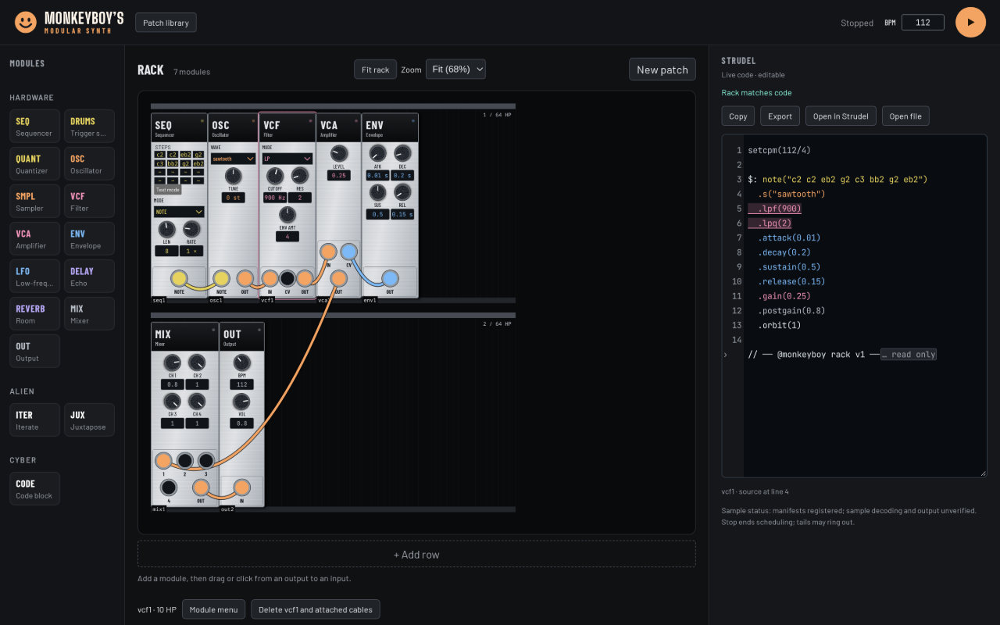

# Rack controls and viewport acceptance

Observed 3 November 2026 for #81, #82, #84, #92, #94 and #95 in the T3 Code
Chromium preview, using Node 24.22.2 and the Vite development build.
The [design contract](design.md#panel-controls-and-rack-zoom-81-82-84-92-94-95)
owns the behavior; this is dated evidence.

## Static and deterministic proof

`npm ci` and `npm run check` passed: formatting, skill integrity, lint,
776 passing Vitest tests, 40 guardrail tests,
TypeScript and production build. The focused numeric behavior test first failed
because keyboard stepping was absent, then passed with logarithmic/fine cutoff,
detents, clamping, range endpoints and reset. Existing generation, source
preservation and persistence suites remain green. No generator, reader, catalog
width or saved-layout format changed.

## Browser observations

- After removing Reset links but before the compact layout, SEQ still needed
  369 px and DRUMS 303 px inside 270 px control regions. The final browser
  matrix passes all 61 module/look combinations at 100%, 75% and Fit zoom
  (183 observations). Every control is inside its panel without inner scrolling;
  all widths equal catalog HP × 12. The 16-step drum view also fits in each of
  the four hardware looks.
- Computed panel type is at least 11 px, numeric readouts and value fields are
  at least 12 px. Zoom scales panel typography visually. The browser checks
  opaque ID and rail-label backgrounds: contrast is 15.85:1 and 11.66:1,
  respectively, independent of the panel look.
- Every jack target is at least 24×24 screen pixels without overlapping another
  target in the matrix, including Fit. Cable coordinates are checked against
  live jack centers. The outgoing fan-out offset remains intentional.
- At 1440×900, Enveloped synth fits both rows at about 68% zoom. The rack
  viewport and scroll extent are both 802×638 px: no inner rack scrolling.
  All seven panels pass the same control/target checks, with six aligned cables.
  Manual 75–150% zoom also retains aligned cables and unchanged source bytes.
- Native Tab navigation from the VCF header reaches MODE then CUTOFF.
  Native ArrowUp changes 900→964 Hz; Shift+ArrowUp changes 964→971 Hz.
  Home/End reach 20/20000 Hz; Backspace resets to 800 Hz. The focused slider
  announces its label, range, number and unit. Each resulting file reads with
  restored saved rack identity and the matching cutoff value.
- Clicking the cutoff readout still edits it. Entering −1 reports
  “Enter 20–20000”, retains 800 and marks the input invalid; 1200 commits.
  Native pointer dragging at Fit changes cutoff; double-click resets to 800.
- During real playback, keyboard 800→857 Hz keeps “Pattern scheduled” and
  produces nonzero WebAudio PCM (RMS 0.00205 after the edit). Native pointer
  dragging changes cutoff to 9146 Hz while scheduling continues; reset and Stop
  remain available. This is measured signal and UI evidence, not physical listening.
- A native cable drag at Fit from ENV OUT to VCF CV connects the intended
  jacks, retains the ENV→VCA cable and restores the saved rack on import.
  The seven cable endpoints remain aligned after the edit. A native palette drag
  at Fit places ITER on the second rail at HP 32. Switching all hardware to
  Vintage lab moves the jacks to the top and retains aligned cables.

After rebasing onto `9ef4a21`, the full gate and 183-observation browser matrix
passed again. A native keyboard edit during playback changed 964→971 Hz while
retaining “Pattern scheduled” and nonzero PCM (RMS 0.00549). Screenshots were
recaptured with the current folded-metadata editor.

The private online design canvas was not accessed; the repository's supplied
PNG/HTML board exports were available as references.

## Reproduction

Start `npm run dev`, open its page, dismiss any local-recovery prompt, and use
the browser console:

```js
const checks = await import('/scripts/rack-feel-check.mjs')
await checks.verifyPanels()
await checks.loadEnveloped()
```

At 1440×900, click **Fit rack**, then run `checks.inspectPanels()` and
`checks.inspectCables()`. The matrix defaults to 100%, 75% and Fit; pass `[1]`
to check only natural size. It uses the actual catalog, reader-backed source
editor and controls; it does not start audio. Native keyboard, drag and playback
observations above were exercised separately through preview actions.

This browser suite runs separately from shared CI, like the existing rack and
editor suites. It requires a provisioned browser. The matrix covers shipped
controls/defaults and the stated drum variant; arbitrary long CODE, unbounded
added drum voices, very large racks/tiny viewports, physical screen-reader
speech, other browsers and subjective audible continuity are not established.

## Screenshot set

The ten look captures use a 1600×1800 CSS viewport at natural zoom so all
family modules are visible. The fit capture uses 1440×900. Preview screenshots
are resampled by the harness; the layout checks use CSS screen coordinates.

| Look           | Screenshot                                                  |
| -------------- | ----------------------------------------------------------- |
| Powder coat    | [All 13 hardware panels](evidence/rack-feel/powder.png)     |
| Instrument     | [All 13 hardware panels](evidence/rack-feel/instrument.png) |
| Vintage lab    | [All 13 hardware panels](evidence/rack-feel/vintage.png)    |
| Learner        | [All 13 hardware panels](evidence/rack-feel/learner.png)    |
| Crystal        | [Both Alien panels](evidence/rack-feel/crystal.png)         |
| Bioluminescent | [Both Alien panels](evidence/rack-feel/bio.png)             |
| Monolith       | [Both Alien panels](evidence/rack-feel/monolith.png)        |
| Terminal       | [CODE](evidence/rack-feel/terminal.png)                     |
| Neon wireframe | [CODE](evidence/rack-feel/neon.png)                         |
| Bare board     | [CODE](evidence/rack-feel/bare.png)                         |


